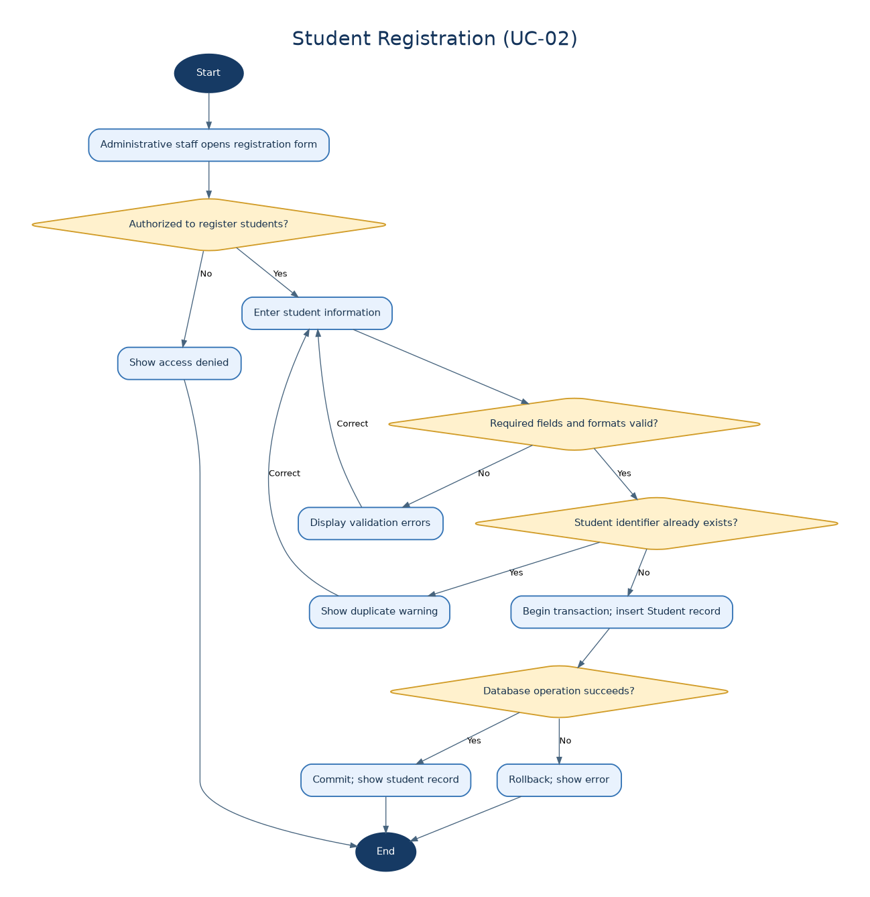
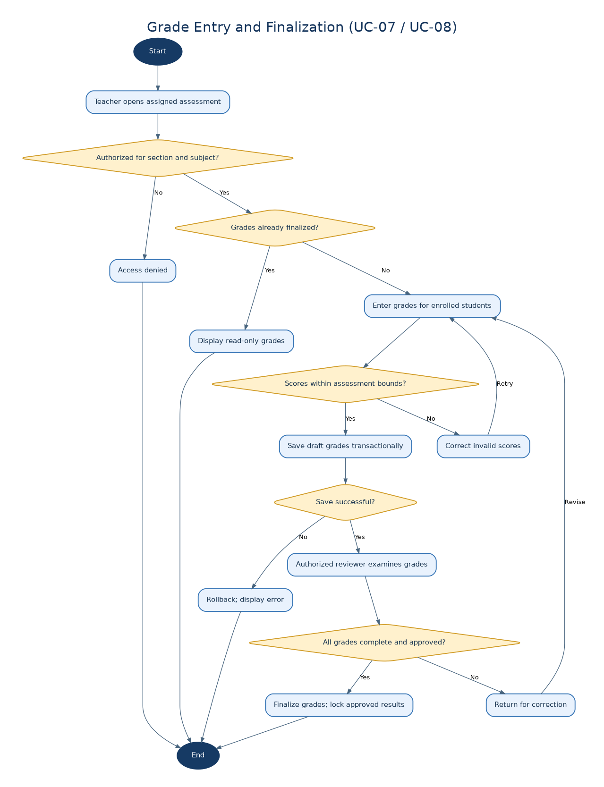
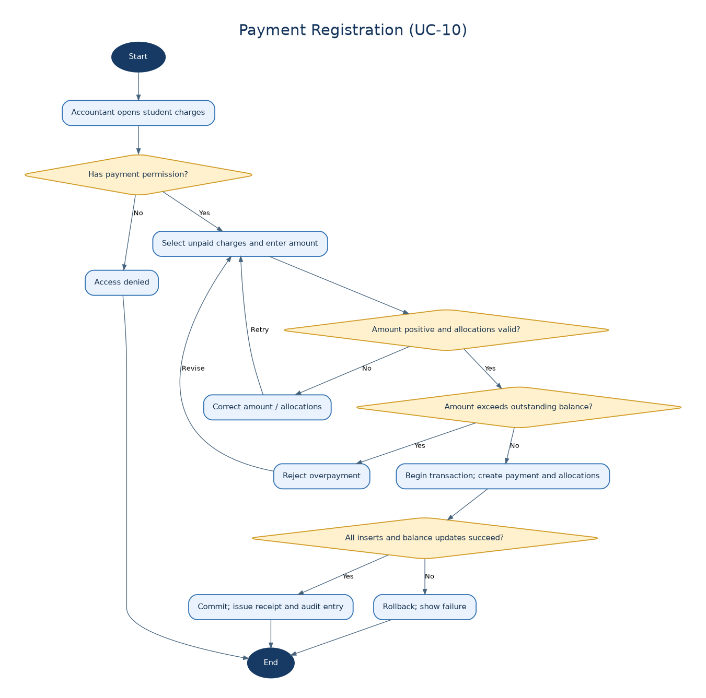
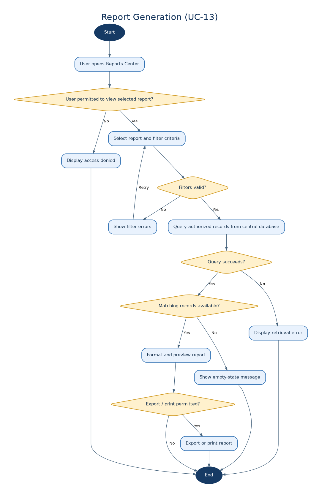

# Activity Diagrams — School Management System

## Purpose
These diagrams describe user-facing workflows, decisions, exceptions and data consistency checks, aligned with the desktop-only system architecture.

## Diagram catalog

### Student Registration (UC-02)

### Grade Entry and Finalization (UC-07 / UC-08)

### Payment Registration (UC-10)

### Report Generation (UC-13)

## Consistency notes
- Students are registered independently of enrollment/section assignment.
- Grade finalization locks approved grades; approval authority must be confirmed in RBAC.
- Payments cannot exceed outstanding balances and allocation is atomic.
- Reports enforce access permissions and filter data accordingly.
