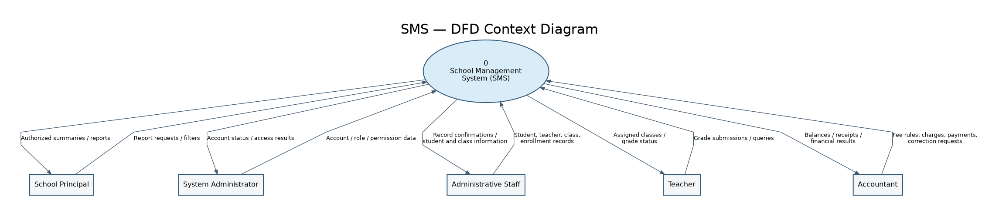
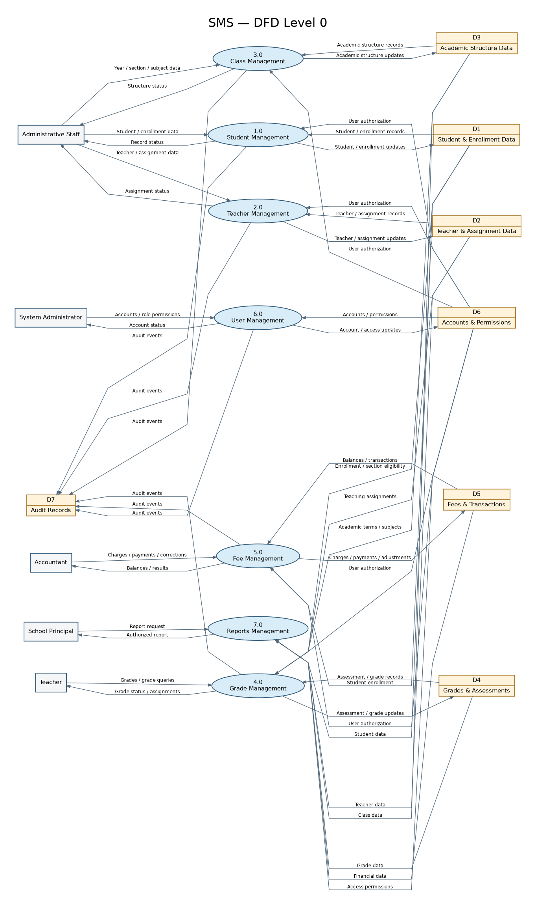

# School Management System — Data Flow Diagrams

**Version:** 1.0 | **Status:** Proposed for review | **Application:** Desktop-only, single school

## Context Diagram

The entire SMS is represented by **Process 0**, interacting with five external actors: School Principal, System Administrator, Administrative Staff, Teacher, and Accountant. External actors are shown as sources/sinks of data, not internal stores.

## DFD Level 0

Processes: **1.0 Student Management; 2.0 Teacher Management; 3.0 Class Management; 4.0 Grade Management; 5.0 Fee Management; 6.0 User Management; 7.0 Reports Management.**

Logical stores: **D1 Student & Enrollment; D2 Teacher & Assignment; D3 Academic Structure; D4 Grades & Assessments; D5 Fees & Transactions; D6 Accounts & Permissions; D7 Audit Records.** These stores represent logical data groups, not one table each.

## Scope and balancing notes

- Both diagrams use the same five external entities; detailed flows in Level 0 collectively correspond to the Context Diagram exchanges.
- Authentication and permission checking are shared behavior of User Management and are not an eighth functional module.
- The diagrams describe logical data movement; they do not depict desktop UI calls, physical network connections, or SQL tables.
- Financial corrections preserve original transactions and are logged. Grade entry requires enrollment and teaching-assignment eligibility.
- Level 0 shows representative flows, not every low-level CRUD operation; it is a review baseline.

## Related documents

- [Process Analysis](../03-System-Analysis/Process-Analysis.md)
- [Functional Requirements](../02-Requirements-Analysis/Functional-Requirements.md)
- [Business Rules](../03-System-Analysis/Business-Rules.md)
- [Database Design](../04-System-Design/Database-Design.md)
